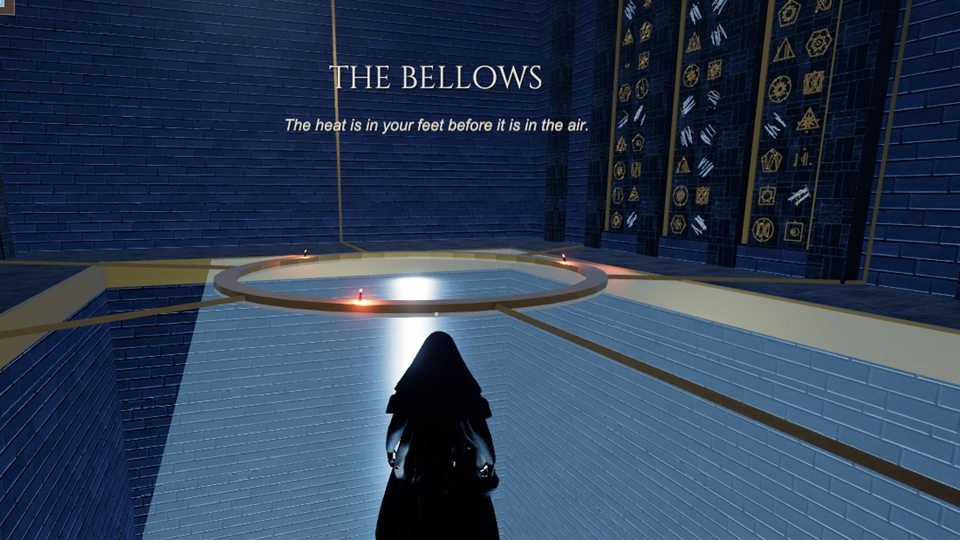
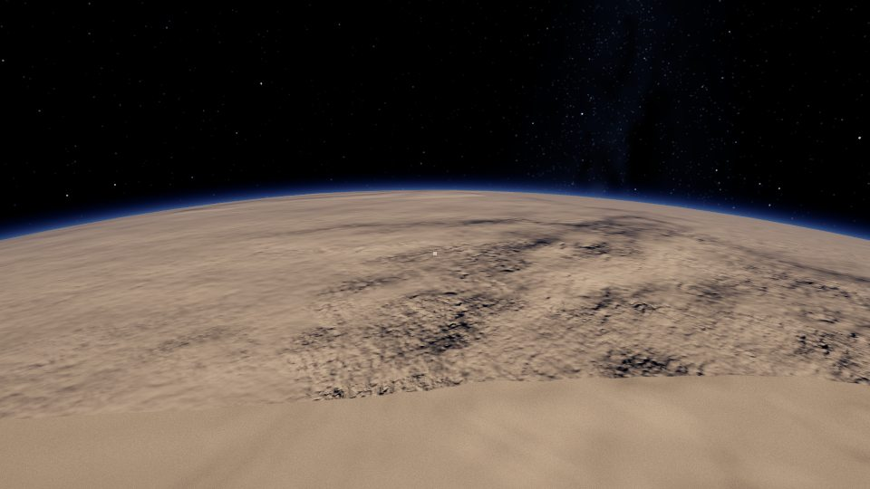
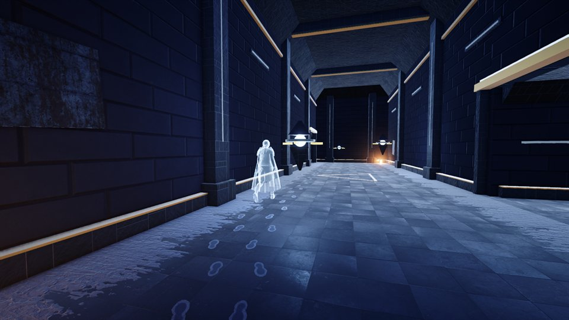
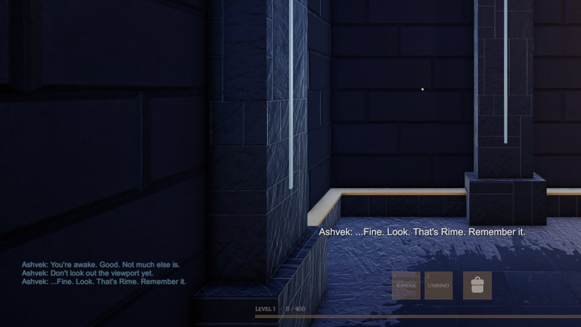
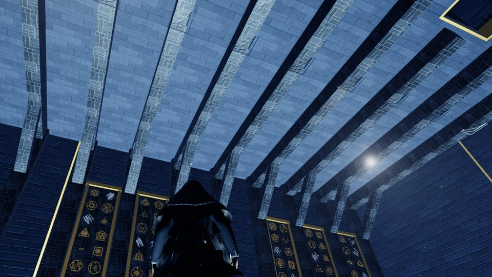

# Pbuild

***Worlds Remain.*** A game by [RawData Studio](https://rawdata.cloud).

Pbuild is a first-person game about building planets and exploring them. You are one of the Vaelin, a people of wanderers, and you wake aboard **Last Lantern**, a vast worldship the vanished Anvari left at the edge of a stilled system. The ship has nearly everything needed to make a world. Making one is easy. Real physics decides what that world becomes, and then you fly down and explore it.

**[pbuild.space](https://pbuild.space)** · In development · No release date yet

> This repository is Pbuild's public home: screenshots, progress, and a place for your questions and ideas. The game's source code is private while we build it.

## The Idea
- **Begin among the Vaelin** (*Children of Light*), under a red dwarf beside a world the Long Cold has frozen, and follow the story of Elizabeth, the Wright who came before you
- **Build a planet in minutes**: set its orbit, mass, composition, spin, tilt, air and water
- **The physics decides the rest**: gravity, temperature, seasons, day length, and whether it can hold an atmosphere or oceans
- **Explore what you made**, from orbit to the ground with no loading screens
- **Uncover an ancient story**: why the Anvari vanished, and what the Long Cold wants

## From the Build
Work-in-progress captures from the current build. Not final art.

  
  

  
  

  
  

  
  

  
  

  
  

## What's in the Build So Far
An early build runs on Windows PC, with mouse and keyboard or an Xbox controller. It isn't available to play yet.

- **The Forge**: write a world at the console and watch its gravity, warmth, seas, ice and clouds follow every dial. Speak it, and it lives its first thousand million years on the hologram until the Keepers answer: it *remains*, it is *slipping*, or it is *unspoken*
- **Worlds seen from space**: coasts, ranges, seas and weather from each world's own physics, under a sky of real stars. A world that lives is really out there, and the ship crosses to it
- **Last Lantern**: walk its halls as a cloaked Wright, from the Cradle and the Observatory to the Hangar, the Spoken Hall and the Bellows far below
- **Elizabeth**, the Vaelin's patched ship: mend her, then fly her out through the Hangar's gate as a real spacecraft and bring her home
- **The opening act**: quests from Ashvek, the ship's damaged Warden, the first fights against the Hushed, a pack, levels, and your own account with up to ten named Wrights
- **The first ground**: come down to a world and its hills, valleys and crags are drawn around you

## Roadmap
| Phase | Status |
| --- | --- |
| Design | Complete · September 2026 |
| Foundations | Complete · September 2026 |
| The Forge | Complete · September 2026 |
| Worlds Seen From Space | Complete · September 2026 |
| One People, Many Stars | Complete · September 2026 |
| The Mood Pass | Complete · November 2026 |
| Foundations for Play | Complete · November 2026 |
| Waking Last Lantern | In progress |
| Worlds You Can Walk | In progress |
| Tending Seeds | Next |
| Together | Planned |
| Living Worlds | Planned |
| The Spiral's Story | Planned |

The full roadmap, with what each phase holds, is on [pbuild.space](https://pbuild.space/#progress).

## Get Involved
- **Questions, ideas, or just want to say hi?** Start a thread in [Discussions](../../discussions).
- **Feedback on something you've seen?** Open an [issue](../../issues/new/choose).
- **Follow along** at [pbuild.space](https://pbuild.space) and [rawdata.cloud](https://rawdata.cloud).

## Built With
Unity 6 (URP) and C#.

---

© 2026 RawData Studio. All rights reserved. The images and text here are shared to show the game, not licensed for reuse.
